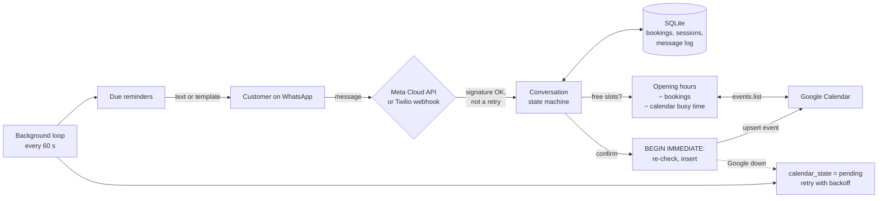

# WhatsApp Booking Bot

A Python bot that lets customers book, reschedule, and cancel appointments over WhatsApp. It writes each booking to Google Calendar and sends reminders before the appointment.

Small service businesses (barbers, physios, tutors) take bookings by phone and text, which means double bookings, missed messages, and no-shows. This bot gives customers a WhatsApp number that answers straight away. Customers can tap through numbered menus or type the whole request in one go ("haircut friday at 2:30pm", "move my appointment to thursday 6pm"). The bot checks opening hours, existing bookings, *and* the owner's own Google Calendar events before it offers a time. The final check runs inside a database transaction, so two people can't take the same slot. Confirmed bookings appear in Google Calendar, and reminders go out a day before and two hours before. Customers can reply "reschedule" or "cancel" straight from a reminder.


*A real run of the bundled simulator. The customer asks for 2pm, which overlaps the owner's dentist appointment, so they pick 15:00 instead. The booking is synced to the calendar, and the 2-hour reminder goes out.*

## How it works



- **Conversation.** [app/bot.py](app/bot.py) is a small state machine for each phone number: *service → day → time → confirm*, with *pick appointment → confirm* for cancelling. The state lives in SQLite, so a restart mid-conversation loses nothing, and a conversation that goes quiet for 30 minutes starts over. At any step, `menu`, `0`, or `cancel` stops the current flow.
- **Free-text dates and times.** [app/timeparse.py](app/timeparse.py) reads `tomorrow 3pm`, `fri at 10:30`, `3rd Nov`, `Nov 3`, `03/11` (day-first or month-first, set per business), `2026-11-03`, `noon`, and `at 3` (which means 15:00 in a booking chat). It deliberately doesn't guess at vague requests like "sometime next week". Those get a numbered list, which is faster than a wrong guess.
- **Availability.** [app/business.py](app/business.py) builds slots from opening hours (with split shifts for a lunch break), closed dates, the service length, minimum notice, the booking horizon, and an optional buffer between appointments. It then removes confirmed bookings and the calendar's busy time. When the requested time is taken, the bot offers the four closest free times rather than a whole day's list.
- **No double bookings.** The final check and the insert run in one `BEGIN IMMEDIATE` transaction. A test fires two threads at the same slot and checks that exactly one gets it.
- **Google Calendar sync.** The database is the source of truth, and the calendar is a copy that is kept in sync. Each booking gets a client-chosen event ID, so a retried insert can't create a duplicate: a `409` means it already exists, so the bot updates that event instead. Rescheduling updates the same event, and cancelling deletes it. If Google is down, the booking still goes through, is marked `pending`, and is retried with exponential backoff (capped at one hour). If the busy-time lookup fails, the bot falls back to the bookings in its own database and keeps taking bookings.
- **The owner's own events.** When the bot reads the calendar, it skips its own events (tagged with `extendedProperties.private.bookingId`), events marked "free", events the owner declined, and cancelled events. Everything else, including all-day events, blocks time.
- **Reminders.** [app/reminders.py](app/reminders.py) sends each configured reminder (by default 1 day and 2 hours before) at most once. A reminder is skipped when the booking was made after its window opened: someone who books 3 hours ahead gets only the 2-hour reminder. After downtime, only the latest due reminder is sent. Rescheduling resets the reminders.
- **WhatsApp channels.** [app/channels.py](app/channels.py) implements both the Meta Cloud API and Twilio with plain `httpx`. That covers webhook parsing (text, button replies and list replies), `X-Hub-Signature-256` and `X-Twilio-Signature` checks, the Meta verification handshake, and dedupe of webhook retries by message ID. Replies go out on whichever channel the message came in on, and reminders on the channel the booking was made from. Webhooks answer immediately and the bot runs as a background task, because Meta retries slow webhooks.

## Tech stack

- Python 3.12, FastAPI, Uvicorn
- SQLite (stdlib `sqlite3`); all times stored in UTC, with business hours in the business's time zone (`zoneinfo`, so daylight saving time is handled)
- WhatsApp Cloud API (Meta) and Twilio WhatsApp, both through `httpx`
- Google Calendar API v3 over REST, with `google-auth` for the service account token
- Vanilla HTML/CSS/JS simulator (no build step)
- pytest: 151 tests, none of which need a network connection or an account. They cover a fake Google Calendar API, Meta and Twilio requests captured through `httpx.MockTransport`, and a controllable clock.
- Docker Compose

## Run it

### Try it in the browser (no accounts needed)

```bash
python -m venv .venv
source .venv/bin/activate              # Windows: .venv\Scripts\activate
pip install -r requirements-dev.txt
cp .env.example .env
uvicorn app.main:create_app --factory --reload
```

Open http://localhost:8000. The left side is a WhatsApp-style chat, where you're the customer. The right side shows what the business sees: bookings with their calendar sync status and which reminders have been sent, the calendar (where you can add busy time such as a dentist appointment), and a **Run check** button. That button runs the reminder check as if it were any time you pick, so you don't have to wait a day to see a reminder.

### Docker

```bash
cp .env.example .env
docker compose up --build
```

Bookings are kept in a named volume. `data/business.json` is mounted read-only, so you can change hours and services and restart without rebuilding.

### Tests

```bash
pytest
```

To regenerate the screenshot from a real run (needs `pip install playwright && playwright install chromium`): `python scripts/make_screenshot.py`.

## Connect real WhatsApp

WhatsApp has to reach your webhook over HTTPS. For local testing, use a tunnel such as `ngrok http 8000` and use its URL below.

**Twilio (quickest to try).** Join the [Twilio WhatsApp sandbox](https://www.twilio.com/docs/whatsapp/sandbox), then set:

```
TWILIO_ACCOUNT_SID=AC...
TWILIO_AUTH_TOKEN=...
PUBLIC_BASE_URL=https://<your-tunnel>.ngrok.app
```

In the sandbox settings, set "When a message comes in" to `https://<your-tunnel>.ngrok.app/webhook/twilio` (HTTP POST). `PUBLIC_BASE_URL` matters because Twilio signs the URL it called, and behind a tunnel or proxy that isn't the URL the app sees.

**Meta WhatsApp Cloud API.** Create an app with the WhatsApp product, then set:

```
META_ACCESS_TOKEN=...          # a System User token for production; the temporary one expires in 24 h
META_PHONE_NUMBER_ID=...
META_APP_SECRET=...            # used to check X-Hub-Signature-256 on every webhook
META_VERIFY_TOKEN=any-string-you-choose
```

In the app's WhatsApp → Configuration page, set the callback URL to `https://<your-tunnel>.ngrok.app/webhook/meta`, enter the same verify token, and subscribe to the `messages` field.

**Reminder templates.** WhatsApp only allows free-form messages within 24 hours of the customer's last message. A reminder a day ahead usually falls outside that window, so in production it has to be an approved template. Create one with two body variables (`{{1}}` the service and `{{2}}` the date and time), for example *"Reminder: your {{1}} is on {{2}}. Reply RESCHEDULE or CANCEL if you can't make it."* Then set `META_REMINDER_TEMPLATE` or `TWILIO_REMINDER_CONTENT_SID`. Without one, reminders go out as plain text. That works in the Twilio sandbox and within the 24-hour window.

## Connect Google Calendar

1. In Google Cloud, enable the **Google Calendar API**, create a **service account**, and download a JSON key into `secrets/google-service-account.json`.
2. In Google Calendar, open the calendar's *Settings and sharing* and share it with the service account's email, with **Make changes to events**.
3. Copy the *Calendar ID* from the same page and set:

```
GOOGLE_CALENDAR_ID=abc123@group.calendar.google.com
GOOGLE_SERVICE_ACCOUNT_FILE=secrets/google-service-account.json
```

Bookings then appear as events like "Haircut – Sam Carter", with the phone number and booking number in the description. Anything else in that calendar that is marked busy (a dentist appointment, a day off) blocks those times for booking. With `GOOGLE_CALENDAR_ID` empty, the bot uses a local calendar in SQLite instead, which is what the simulator shows.

## Configure the business

Edit [data/business.json](data/business.json):

| Key | Example | Meaning |
| --- | --- | --- |
| `name`, `address` | `Harbour Lane Barbers` | Shown in confirmations and reminders |
| `timezone` | `Europe/London` | Hours, dates and reminders use this zone |
| `date_order` | `DMY` | How `03/11` is read (`MDY` for the US) |
| `hours` | `"tue": [["09:00","12:30"],["13:30","18:00"]]` | One or more intervals per weekday; `[]` means closed |
| `closed_dates` | `["2026-12-25"]` | Holidays |
| `services` | `{"id": "haircut", "name": "Haircut", "minutes": 30, "price": "£22", "aliases": ["cut", "trim"]}` | Aliases are matched as whole words in free text |
| `slot_step_minutes` | `15` | Gap between offered start times |
| `buffer_minutes` | `0` | Minimum gap between appointments |
| `min_notice_minutes` | `120` | No bookings sooner than this |
| `booking_horizon_days` | `14` | No bookings further ahead than this |
| `max_upcoming_per_customer` | `3` | Limits abuse from a single number |
| `reminders_minutes_before` | `[1440, 120]` | When reminders go out |

Environment settings (WhatsApp, Google, timing) are listed and explained in [.env.example](.env.example).

## API

| Endpoint | Purpose |
| --- | --- |
| `GET /webhook/meta` | Meta's verification handshake |
| `POST /webhook/meta` | Meta messages (signature checked, retries deduplicated) |
| `POST /webhook/twilio` | Twilio messages (signature checked) |
| `GET /api/health` | Status, active channels, calendar backend |
| `/api/sim/*` | Simulator endpoints, only when `SIMULATOR_ENABLED=true` |

## Limitations

- **One calendar means one chair.** Availability assumes one person serving one customer at a time. Several staff members would need a calendar and slot list per person, plus a "who would you like?" step.
- **Calendar sync is one-way.** If the owner drags a booking's event to a new time in Google Calendar, the database doesn't pick up the change: the customer's reminder still uses the original time. The owner's *own* events are read on every availability check, so they do block time.
- **One process.** Reminders, calendar retries, and the per-customer message lock run inside the app process, so it runs with `--workers 1`. That handles a single business easily. Running several instances would need a shared lock and a separate scheduler.
- **Reminders are at-least-once.** A reminder is marked sent after the WhatsApp API accepts it. A crash between those two steps would send it again on the next pass.
- **The simulator has no authentication.** Leave `SIMULATOR_ENABLED=false` on any public deployment. It exposes bookings and phone numbers.
- **Only text and numbered lists.** The bot reads button and list replies but doesn't send WhatsApp interactive messages itself. Numbered text lists work the same on Twilio and Meta.
- **English only, with simple date parsing.** Phrases like "after work" or "the week after next" get a list of days instead.
- **Not tested against live accounts.** The Meta and Twilio payloads, signatures, and Google Calendar requests follow the providers' documentation and are tested against fakes. Run them against your own sandbox accounts before relying on them. If `META_APP_SECRET` is empty, webhook signatures aren't checked (a warning is logged at startup), which is only acceptable for local testing.

The business, customers, and phone numbers in this repository are made up. The phone numbers are from Ofcom's reserved drama range.

## sort entries

Updated implementation details.

## invalidate cache

Updated implementation details.

## hash password

Updated implementation details.

## sort entries

Updated implementation details.

## invalidate cache

Updated implementation details.

## hash password

Updated implementation details.